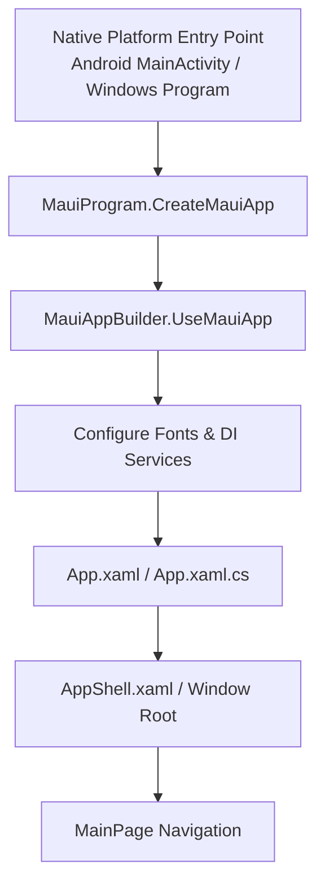

# 01. MAUI Startup & Lifecycle (Життєвий цикл та ініціалізація)

### Що це?
Кожен .NET MAUI застосунок починає роботу з точки входу `MauiProgram.CreateMauiApp()`, де налаштовується хост `MauiAppBuilder`, реєструються сервіси Dependency Injection (DI), шрифти та плагіни.

### Аналогія з реального життя
Уявіть відкриття ресторану: шеф-кухар перевіряє обладнання, закуповує інструменти (DI сервіси), друкує меню (AppShell) і лише після цього відчиняє двері для гостей (`MainPage`).

### Архітектура старту

### Ключові концепції
1. `MauiProgram.cs` — єдина точка збірки клієнта для всіх ОС.
2. `App.xaml` — глобальні стилі, ресурси та колірна палітра.
3. `AppShell.xaml` — візуальна ієрархія та маршрутизація сторінок.