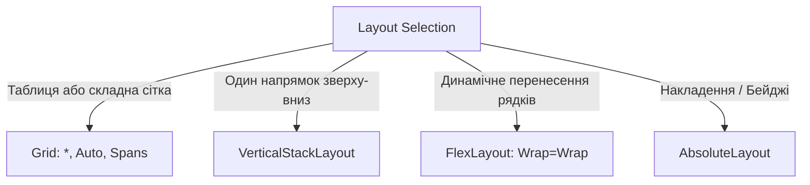

# 02. MAUI Layouts Deep Dive (Глибоке занурення в контейнери розмітки)

### Що це?
У .NET MAUI контейнери розмітки керують взаємним розташуванням, відступами та адаптивністю візуальних елементів на різних екранах (від телефонів до 4K моніторів).

### Порівняльна таблиця контейнерів
| Контейнер | Поведінка | Оптимальне використання |
|---|---|---|
| `Grid` | Рядки та стовпці (`Auto`, `*`, абсолютні пікселі) | Комплексні форми, панелі керування, картки |
| `VerticalStackLayout` | Вертикальний стек один за одним | Прості списки, послідовності елементів форми |
| `HorizontalStackLayout` | Горизонтальний рядок елементів | Панелі кнопок, індикатори дій |
| `FlexLayout` | CSS-подібний Flexbox з автоматичним перенесенням | Чіпси, теги, галереї фотографій |
| `AbsoluteLayout` | Координатне та пропорційне позиціонування | Оверлеї, значки повідомлень, плаваючі бейджі |

