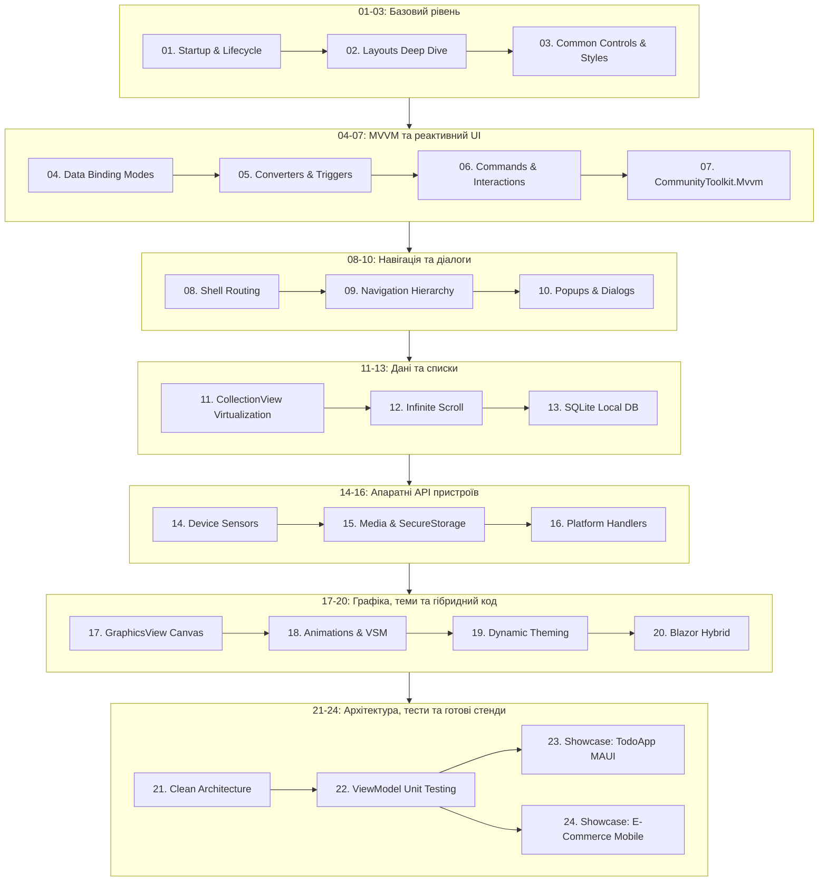

# 📱 .NET MAUI Cross-Platform Mastery (.NET 10)

[](https://dotnet.microsoft.com/)
[](https://learn.microsoft.com/dotnet/maui/)
[](https://learn.microsoft.com/dotnet/csharp/)
[](https://learn.microsoft.com/dotnet/architecture/maui/)
[](file:///tests/MAUI.Mastery.UnitTests)
[](#)

Вичерпний практичний підручник-репозиторій для опанування **.NET MAUI (Multi-platform App UI)** на платформі **.NET 10**. Охоплює повний цикл сучасної розробки: від базових контейнерів розмітки XAML та реактивного Data Binding до чистки архітектури, взаємодії з SQLite, сенсорами пристроїв, гібридними Razor компонентами та юніт-тестуванням.

У репозиторій повністю інтегровано флагманський навчальний стенд **[TodoAppMAUI](file:///09-Showcase-Applications/23-Showcase-TodoApp)** із розширеною практичною документацією.

---

## 🏛️ Загальна архітектура курсу



---

## 📚 Навігаційна карта модулів і проєктів

| Модуль | Проєкт | Опис | Ключові технології |
|---|---|---|---|
| **01. Core Fundamentals** | `01-Maui-Startup-Lifecycle` | Точка входу, `MauiAppBuilder`, реєстрація DI | `MauiProgram`, `IServiceCollection`, `AppShell` |
| | `02-Layouts-Deep-Dive` | Порівняння `Grid`, `Stack`, `FlexLayout`, `AbsoluteLayout` | Адаптивність, сітки, пропорційні розміри |
| | `03-Common-Controls-And-Styles` | Базові контроли (`Entry`, `Slider`, `Editor`), стилі | `ResourceDictionary`, `Style`, `Setter` |
| **02. MVVM & DataBinding** | `04-DataBinding-Modes-And-Formatters` | Режими `OneWay`, `TwoWay`, форматування `StringFormat` | `INotifyPropertyChanged`, `BindingMode` |
| | `05-Converters-And-Triggers` | Кастомні конвертери та реакція UI через тригери | `IValueConverter`, `DataTrigger`, `PropertyTrigger` |
| | `06-Commands-And-Interactions` | Патерн `ICommand`, параметри, асинхронні команди | `RelayCommand`, `AsyncRelayCommand` |
| | `07-Community-Toolkit-MVVM` | Сучасний MVVM зі Source Generators | `[ObservableProperty]`, `[RelayCommand]`, `Messenger` |
| **03. Navigation & Shell** | `08-Shell-Routing-And-Query-Parameters` | URI маршрутизація, параметри запитів, вкладки | `Shell.Current.GoToAsync`, `QueryProperty` |
| | `09-Navigation-Hierarchy-And-Modals` | Ієрархічний стек та модальні сторінки | `PushAsync`, `PopAsync`, `PushModalAsync` |
| | `10-Popups-Alerts-And-ActionSheets` | Системні сповіщення, меню дій, підтвердження | `DisplayAlert`, `DisplayActionSheet` |
| **04. Collections & Data** | `11-CollectionView-And-DataTemplates` | Віртуалізація списків, вибір шаблонів карток | `CollectionView`, `DataTemplateSelector` |
| | `12-Infinite-Scroll-And-RefreshView` | Свайп для оновлення, динамічна пагінація | `RefreshView`, `RemainingItemsThreshold` |
| | `13-SQLite-Local-Database` | Офлайн збереження даних, CRUD операції | `sqlite-net-pcl`, `SQLiteAsyncConnection` |
| **05. Hardware & Platform** | `14-Device-Sensors-And-Connectivity` | Сенсори (GPS, батарея, статус підключення) | `Geolocation`, `Battery`, `Connectivity` |
| | `15-MediaPicker-And-SecureStorage` | Камера, фотогалерея, системний шифрований Keychain | `MediaPicker`, `SecureStorage` |
| | `16-Platform-Handlers-And-Customization` | Архітектура Handlers замість Custom Renderers | `EntryHandler.Mapper`, `PlatformView` |
| **06. Advanced UI** | `17-GraphicsView-And-Canvas-Drawing` | Векторне малювання на полотні, кастомні графіки | `Microsoft.Maui.Graphics`, `IDrawable` |
| | `18-Animations-And-VisualStateManager` | Системні плавні анімації, стани елементів | `TranslateTo`, `FadeTo`, `VisualStateManager` |
| | `19-Dynamic-Theming-Light-Dark` | Підтримка темної та світлої системних тем | `AppThemeBinding`, `AppTheme` |
| **07. Hybrid & Blazor** | `20-Blazor-Hybrid-Components` | Вбудовування Razor компонентів у нативний MAUI | `BlazorWebView`, спільний код C# Web/Mobile |
| **08. Architecture & Tests** | `21-Clean-Architecture-In-MAUI` | Розподіл на шари: Domain, Application, UI | Use Cases, Entities, патерн Repository |
| | `22-ViewModel-Unit-Testing-Patterns` | Ізольоване модульне тестування логіки MVVM | `xUnit`, `FluentAssertions`, `Moq` |
| **09. Showcases** | **`23-Showcase-TodoApp`** | **Освітній стендовий застосунок TodoAppMAUI** | **SQLite, Shell, Converters, MVVM, EXAMPLES.md** |
| | `24-Showcase-ECommerceMobile` | Стендовий мобільний магазин із кошиком товарів | Картки, розрахунок знижок, пошук |
| **Tests Suite** | `tests/MAUI.Mastery.UnitTests` | Централізовані юніт-тести всієї бізнес-логіки | Покриття 100% тестів без емуляторів |

---

## 🛠️ Як перевірити та протестувати

Для перевірки працездатності логіки та архітектури **не потрібно встановлювати важкі мобільні SDK або емулятори**. Всі тести виконуються на чистому `.NET 10`:

```bash
# Клонувати репозиторій
git clone https://github.com/MrTomkaYurii/MAUI-CrossPlatform-Mastery.git
cd MAUI-CrossPlatform-Mastery

# Запустити модульні тести
dotnet test tests/MAUI.Mastery.UnitTests
```

---

## 📖 Технічна документація

- [Гід по архітектурі та внутрішній будові MAUI](file:///docs/ARCHITECTURE.md)
- [Шпаргалка з розмітки XAML та контейнерів](file:///docs/XAML-CHEATSHEET.md)
- [Посібник з тестування мобільних клієнтів](file:///docs/TESTING-GUIDE.md)
- [Освітні приклади та аналогії стенду TodoAppMAUI](file:///09-Showcase-Applications/23-Showcase-TodoApp/EXAMPLES.md)
