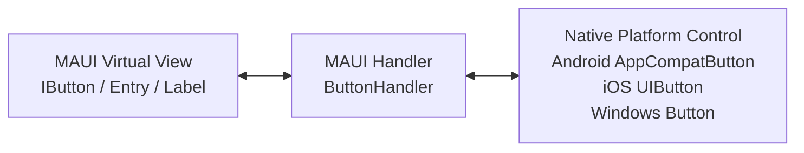
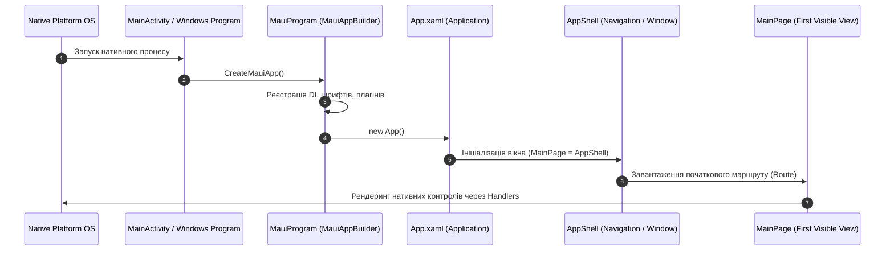

# .NET MAUI Architecture & Internals Deep Dive

Цей документ розкриває архітектурні принципи та внутрішню будову **.NET MAUI (Multi-platform App UI)** у версії **.NET 10**.

---

## 1. Еволюція: від Xamarin.Forms до .NET MAUI

| Характеристика | Xamarin.Forms (Legacy) | .NET MAUI (Modern .NET 10) |
|---|---|---|
| **Архітектура проєктів** | Окремий проєкт для Android, iOS, UWP + спільна бібліотека | **Single Project (`.csproj`)** з мультитаргетингом |
| **Маппінг віджетів** | Важкі `CustomRenderers` (тісно зв'язані з UI) | **Легкі `Handlers`** (через інтерфейси `VirtualView`) |
| **Графічна підсистема** | Залежність від платформних Canvas | Уніфікований `Microsoft.Maui.Graphics` |
| **Хостинг та DI** | Власний `DependencyService` (сервіс-локатор) | **`Microsoft.Extensions.DependencyInjection`** (стандартний .NET Host) |
| **Швидкість старту** | Повільна ініціалізація віджетів | До 45% швидший холодний старт завдяки source generators |

---

## 2. Архітектура Handlers

У .NET MAUI кожне візуальне представлення (`Virtual View`, наприклад `Button` або `Entry`) відділене від нативного віджета платформи (`Native View`, наприклад `Android.Widget.Button` або `Microsoft.UI.Xaml.Controls.Button`) за допомогою **Handler**:



### Переваги Handlers:
1. **Інтерфейсна ізоляція**: Handler працює виключно з кросплатформеним інтерфейсом (наприклад, `IButton`), не знаючи про внутрішню реалізацію конкретного класу.
2. **Легка кастомізація без підкласів**:
```csharp
// Модифікація поведінки всіх Entry в застосунку
Microsoft.Maui.Handlers.EntryHandler.Mapper.AppendToMapping("CustomUnderline", (handler, view) =>
{
#if ANDROID
    handler.PlatformView.Background = null;
#elif WINDOWS
    handler.PlatformView.BorderThickness = new Microsoft.UI.Xaml.Thickness(0, 0, 0, 2);
#endif
});
```

---

## 3. Життєвий цикл та ініціалізація додатку



---

## 4. Потокова модель (Threading & MainThread)

- **UI Thread (MainThread)**: усі операції з візуальними елементами (`XAML Controls`, зміна властивостей `INotifyPropertyChanged`, прив'язаних до UI) мають відбуватися виключно в головному потоці.
- **Background Threads**: тривалі задачі (запити до REST API, робота з базою даних SQLite, парсинг великих JSON файлів) виконуються асинхронно у фоні через `Task.Run` або `async/await`.

Для повернення результату у головний потік використовується `MainThread.BeginInvokeOnMainThread`:
```csharp
MainThread.BeginInvokeOnMainThread(() =>
{
    ActiveUsersCount++;
});
```
